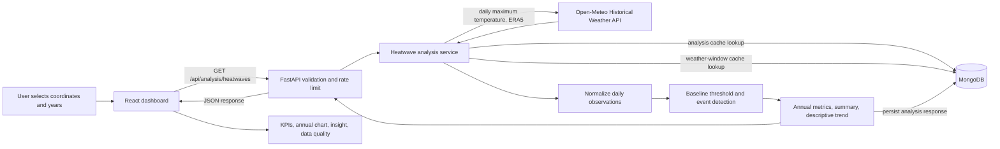

# Climate Hazard Trend Analyzer — Thermal Atlas

Thermal Atlas is a full-stack case study for exploring historical heatwave indicators at a selected coordinate. A user chooses a location and year range; the application retrieves daily maximum temperatures, applies a fixed-baseline heatwave rule, and presents calculated event counts, duration, intensity, annual series, and a descriptive trend.

The project focuses on heatwaves. Metrics are computed from the weather data returned for each request; the frontend does not generate climate metrics. This indicator is descriptive and does not attribute individual events or trends to a cause.

## Features

- React and TypeScript dashboard with location presets, editable coordinates, year-range controls, KPI summaries, an annual Recharts chart, computed insight, and data-quality details.
- Loading, empty, validation, and request-error states.
- FastAPI health and analysis endpoints with typed query validation and response schemas.
- Open-Meteo ERA5 daily maximum-temperature retrieval in Celsius.
- Observation normalization, a fixed 1981–2010 percentile baseline, consecutive-day event detection, annual aggregation, and a least-squares event-count trend slope.
- MongoDB persistence for weather windows and analysis responses, with unique cache keys and TTL indexes.
- Per-process request limiting and configurable CORS.
- Dockerfiles and Docker Compose configuration for local frontend, API, and MongoDB services.

## Tech stack

| Area              | Implementation                                                            |
| ----------------- | ------------------------------------------------------------------------- |
| Frontend          | Vite, React, TypeScript, Tailwind CSS v4, shadcn Select (Base UI), Lucide |
| Visualization     | Recharts                                                                  |
| Backend           | Python 3.14+, FastAPI, Pydantic, HTTPX                                    |
| Persistence/cache | MongoDB 8 in the Compose file; PyMongo asynchronous client                |
| Weather data      | Open-Meteo Historical Weather API, ERA5, `temperature_2m_max`             |
| Backend tests     | Pytest, pytest-asyncio, FastAPI TestClient, HTTPX mock transport          |
| Frontend checks   | ESLint and TypeScript/Vite build; no frontend test script is configured   |
| Package managers  | `uv` for Python; Bun for frontend (`frontend/bun.lock`)                   |
| Containers        | Dockerfiles, Nginx for built frontend, Docker Compose                     |

The repository began with a Vite/React frontend and retains Vite rather than migrating to the Next.js stack suggested in the initial plan.

## Architecture



On an analysis-cache miss, the service loads the selected period and the 1981–2010 baseline. It checks MongoDB for each exact weather window before calling Open-Meteo. Normalization and heatwave calculations are separate service modules; the route handles HTTP validation and translates expected provider, baseline, and database errors.

## Project structure

```text
.
├── .env.example
├── docker-compose.yml
├── plan.md
├── task.md
├── backend/
│   ├── app/
│   │   ├── main.py                         # FastAPI setup, lifespan, CORS
│   │   ├── api/routes/                     # Health and heatwave routes
│   │   ├── schemas/analysis.py             # Pydantic response models
│   │   ├── services/
│   │   │   ├── weather_provider.py         # Open-Meteo HTTP client and parsing
│   │   │   ├── normalization.py            # Daily date/value normalization
│   │   │   ├── heatwave.py                 # Percentile and event detection
│   │   │   └── analysis.py                 # Orchestration and aggregation
│   │   └── repositories/analysis_repository.py # MongoDB cache operations
│   ├── tests/                              # Provider, logic, API, cache tests
│   ├── pyproject.toml
│   ├── uv.lock
│   └── Dockerfile
└── frontend/
    ├── src/App.tsx                         # Dashboard and user interactions
    ├── src/api.ts                          # Typed API client
    ├── src/AnnualChart.tsx                 # Annual Recharts visualization
    ├── src/components/ui/select.tsx        # shadcn Select component
    ├── package.json
    ├── bun.lock
    ├── Dockerfile
    └── nginx.conf
```

## Prerequisites and local setup

- Python 3.14 or newer and [uv](https://docs.astral.sh/uv/).
- [Bun](https://bun.sh/) for the frontend lockfile and scripts.
- MongoDB 8 locally, or Docker with the Docker Compose plugin.
- Backend internet access to request Open-Meteo data on cache misses.

No Open-Meteo API key is configured or required by this application.

### 1. Configure environment

From the repository root:

```powershell
Copy-Item .env.example .env
```

Defaults are suitable for local development. See [Environment variables](#environment-variables) before changing them.

### 2. Start MongoDB

With Docker Compose:

```powershell
docker compose up -d mongodb
```

Alternatively, run MongoDB locally at `mongodb://localhost:27017` (or change `MONGODB_URL`). Collections and indexes are created when an analysis is first requested; no manual schema migration or seed data is included.

### 3. Install Python dependencies and run the API

```powershell
cd backend
uv sync
uv run uvicorn app.main:app --reload --env-file ../.env
```

The API listens at `http://127.0.0.1:8000`. Interactive OpenAPI documentation is at `http://127.0.0.1:8000/docs`; health is at `http://127.0.0.1:8000/api/health`.

### 4. Install frontend dependencies and run the dashboard

In a second terminal, from the repository root:

```powershell
cd frontend
bun install
bun run dev
```

Vite serves the dashboard at `http://localhost:5173`. The frontend reads `VITE_API_BASE_URL` from the root `.env` through Vite's `envDir` setting. Restart Vite after changing it.

### Verify tests and frontend build

Backend tests, from `backend/`:

```powershell
uv run pytest
```

Frontend lint and build, from `frontend/`:

```powershell
bun run lint
bun run build
```

### Run all services with Docker Compose

After installing Docker and creating the root `.env`:

```powershell
docker compose up --build
```

The dashboard is at `http://localhost:5173`, the API at `http://localhost:8000`, and MongoDB at `localhost:27017`. Compose binds ports to loopback. This is local container orchestration; no cloud deployment URL or provider-specific production deployment configuration is present.

## Environment variables

The root `.env.example` contains defaults/placeholders only. No credentials are committed.

| Variable            | Required?                                       | Default                     | Purpose                                                           |
| ------------------- | ----------------------------------------------- | --------------------------- | ----------------------------------------------------------------- |
| `MONGODB_URL`       | Not for health; needed for analysis persistence | `mongodb://localhost:27017` | MongoDB connection URI.                                           |
| `MONGODB_DATABASE`  | No                                              | `hazard_trend_analyzer`     | Database containing `weather_cache` and `analysis_cache`.         |
| `FRONTEND_ORIGIN`   | No                                              | `http://localhost:5173`     | Comma-separated allowed browser origins for backend CORS.         |
| `VITE_API_BASE_URL` | No                                              | `http://127.0.0.1:8000/api` | Frontend API prefix; in Compose it is passed as a build argument. |

The backend reads MongoDB and CORS settings from the process environment. Vite exposes only variables prefixed with `VITE_` to frontend code.

## Data sources

The backend calls the [Open-Meteo Historical Weather API](https://open-meteo.com/en/docs/historical-weather-api) at `https://archive-api.open-meteo.com/v1/archive`. It requests daily `temperature_2m_max`, Celsius, UTC dates, and the `era5` model explicitly. The selected location/range and the fixed baseline are separate weather windows, unless matching windows are cached.

Open-Meteo documents ERA5 as a global reanalysis dataset from 1940 at roughly 0.25° (~25 km) resolution, updated with a delay. A requested point is a gridded reanalysis estimate informed by observations and models, not a measurement from a particular city station. Recent data may be unavailable or incomplete. See the provider's [documentation](https://open-meteo.com/en/docs/historical-weather-api) for current model availability and resolution.

The UI's named presets are coordinate conveniences, and latitude/longitude remain editable. The provider may return nearest grid-cell coordinates; the response identifies the requested coordinates.

Open-Meteo's free API is limited to non-commercial use and requires CC BY 4.0 attribution under its [terms](https://open-meteo.com/en/terms). The dashboard links to Open-Meteo. Check current terms and choose an appropriate plan before commercial use; provider terms can change.

## Heatwave detection and methodology

### Baseline threshold

The baseline is fixed at **1981–2010**, independent of selected analysis years. The backend requests daily maximum temperatures for that full period and pools all valid baseline days into one distribution. It does not use a seasonal or day-of-year threshold.

The threshold is the empirical 95th percentile in °C. Values are sorted and linearly interpolated at index `(n - 1) × 0.95`. At least 80% of expected baseline days must be valid, otherwise analysis stops with an insufficient-baseline error. This pooled annual distribution is simple and reproducible but does not adjust for seasonal temperature cycles.

### Events and metrics

1. The selected year range expands to calendar dates, January 1 through December 31. For the current year, the end date is capped at today.
2. The series is normalized to one entry per expected UTC calendar day. Duplicate dates, out-of-period dates, non-finite values, and values outside −90°C to 70°C are excluded. Missing dates and null values remain missing; no interpolation is performed.
3. A hot day is a valid daily maximum **strictly greater than** the baseline threshold. Three or more consecutive hot days make one event. A day at threshold, a missing/null day, or a date gap breaks the run.
4. An event crossing a calendar year remains one event assigned to its start year. Events are evaluated only within the requested window, so runs already underway before the first requested day are clipped.
5. Event duration is the number of consecutive hot days. Event intensity is the mean daily excess above the threshold, in °C, for that event. Period and annual mean duration/intensity average detected events; they are `null` when there are no events.
6. Annual frequency is the number of events assigned to each start year. A year without observations has `data_available: false`; an observed year with no events has count zero.
7. Trend is the least-squares slope of annual event count against calendar year, using only years with at least one valid observation. It is expressed in events per year. Direction is called stable when slope is within 0.01 of zero; otherwise it is increasing or decreasing. There is no confidence interval, significance test, or percentage-change metric.

Missing or invalid selected-period observations appear in quality counts and cannot bridge a hot-day run. Baseline coverage is checked separately from selected-period coverage. This indicator is not a formal attribution result or proof of causation.

## API documentation

FastAPI provides interactive OpenAPI documentation at `/docs` and the schema at `/openapi.json` when the backend is running.

### `GET /api/health`

Returns `{"status":"ok"}` when the application process responds. It does not check MongoDB or Open-Meteo connectivity.

### `GET /api/analysis/heatwaves`

Example request:

```text
GET http://127.0.0.1:8000/api/analysis/heatwaves?latitude=22.5726&longitude=88.3639&start_year=2010&end_year=2024&location_label=Kolkata
```

| Query parameter  | Required | Validation / behavior                                                                             |
| ---------------- | -------- | ------------------------------------------------------------------------------------------------- |
| `latitude`       | Yes      | Finite number from −90 through 90.                                                                |
| `longitude`      | Yes      | Finite number from −180 through 180.                                                              |
| `start_year`     | Yes      | Integer, at least 1940, and no later than `end_year`.                                             |
| `end_year`       | Yes      | Integer, at least 1940, not in the future, and no more than 40 inclusive years from `start_year`. |
| `location_label` | No       | Display label only; max 100 characters. It is excluded from the analysis cache key.               |

Success follows the Pydantic `HeatwaveAnalysisResponse` model in `backend/app/schemas/analysis.py`:

| Field               | Contents                                                                       |
| ------------------- | ------------------------------------------------------------------------------ |
| `location`          | Requested latitude, longitude, and optional label.                             |
| `period`            | Start and end year.                                                            |
| `data_source`       | Provider, model, variable, and unit.                                           |
| `baseline`          | Years, percentile/method, valid and expected days, and coverage.               |
| `threshold_celsius` | Calculated baseline threshold.                                                 |
| `data_quality`      | Expected, observed, missing/null, and excluded invalid selected-period counts. |
| `total_events`      | Number of detected events in the selected period.                              |
| `summary`           | Period mean duration and mean intensity, or null when there are no events.     |
| `annual_metrics`    | Per-year event count, mean/max duration, mean intensity, and `data_available`. |
| `insight`           | Computed trend text, direction, and slope in events per year when estimable.   |
| `caveats`           | Applicable method, coverage, current-period, and interpretation notes.         |
| `cache`             | Cache-hit flag and analysis generation timestamp when available.               |

The API does not calculate percentage change. Trend direction and slope are not statistical significance tests.

| HTTP status | Meaning                                                      |
| ----------- | ------------------------------------------------------------ |
| `200`       | Analysis response returned.                                  |
| `400`       | Reversed years, a future end year, or a span over 40 years.  |
| `404`       | No weather data is available for the requested period.       |
| `422`       | Query validation failed or baseline coverage is below 80%.   |
| `429`       | Backend process-local request limit reached.                 |
| `502`       | Weather provider unavailable, invalid response, or timeout.  |
| `503`       | Provider rate-limited the backend or MongoDB is unavailable. |

Errors use FastAPI's `detail` field. Provider/database failures are translated to safe client messages rather than exposing internal exception details.

## Database and caching

MongoDB stores documents in two collections:

- **`weather_cache`** stores provider/model version, requested and returned coordinates, date window, daily temperature observations, storage time, and expiry. Its key includes provider version, coordinates rounded to five decimal places, and exact start/end dates. Weather windows expire after 30 days.
- **`analysis_cache`** stores algorithm version, serialized response, generation time, and expiry. Its SHA-256 key includes algorithm version, coordinates rounded to five decimals, and start/end years. The location label is not part of the key and is applied to returned location metadata. Analysis documents expire after 24 hours.

The repository creates a unique cache-key index and a TTL index on `expires_at` for each collection on the first analysis request. MongoDB TTL deletion is asynchronous; reads also reject expired records. There are no user accounts or separate relational tables.

The API limits each client IP to 30 analysis requests per minute per backend process. This in-memory limit is not shared across workers/replicas. MongoDB-backed cache documents persist across API restarts until expiry; the limiter does not.

## Testing

Run backend tests from `backend/` with `uv run pytest`. The existing suite covers:

- Percentile interpolation, insufficient baseline coverage, three-day events, short runs, threshold equality, null/missing-date breaks, and cross-year events.
- Normalization, duplicates, gaps, invalid values, and data-quality counts.
- Open-Meteo request parameters and parsing, null/empty/malformed responses, provider errors, rate limiting, and timeouts using HTTPX mock transports.
- Response aggregation, annual availability, cache hit/miss/expiry, health, OpenAPI schema, and API validation.

No frontend test framework or test script is configured. Frontend checks are `bun run lint` and `bun run build`.

## Assumptions and limitations

- One fixed 1981–2010 baseline and pooled all-days threshold are used. There is no seasonal threshold or baseline selector.
- Events require strict threshold exceedance over at least three consecutive UTC dates. Analysis-window boundaries clip runs.
- ERA5 represents a gridded reanalysis point, not local station data; local microclimates may differ.
- The −90°C to 70°C range is a broad plausibility guard, not full scientific quality control.
- Missing/null days are not interpolated and break event sequences. Baseline coverage below 80% stops analysis; no separate minimum selected-period coverage is enforced.
- Current-year results can be partial, and ERA5 is updated with a delay. The response includes a partial-year caveat when applicable.
- Trend is a descriptive linear fit. It does not test statistical significance, account for serial correlation, or establish cause. Percentage changes are not calculated.
- Rate limiting is process-local. Multi-worker production use would need shared limiting plus deployment-specific security and observability.
- No hosted deployment URL or cloud deployment configuration is included. Frontend automated tests are not configured.

## AI tools and development assistance

I used OpenAI Codex and ChatGPT as development assistants during the ideation and implementation process. They helped me explore solution approaches, organize parts of the application structure, refine selected frontend design and UI implementation decisions, and assist with backend structure and test development. I reviewed and adapted their suggestions while working on the implementation and validating the resulting code.

## Future improvements

- Add frontend interaction/accessibility tests for controls, charts, and API error states.
- Evaluate user-selectable or rolling baselines and seasonal/day-of-year thresholds with appropriate climate-method documentation.
- Add stronger data-quality checks and explicit selected-period coverage guidance.
- Add uncertainty intervals and a validated trend significance method instead of reporting only a least-squares slope.
- Use shared rate limiting for multi-worker deployments; add production logging, monitoring, and dependency health checks.
- Add and verify deployment-specific instructions before publishing a hosted URL.
- Consider additional hazards only after the heatwave workflow is fully validated.

## Deployment and demo

The repository includes local Docker Compose orchestration, a backend container, and a frontend build served by Nginx. Run the local stack using `docker compose up --build` as described in [Local setup](#prerequisites-and-local-setup). No hosted application URL, cloud deployment manifest, or live demo is present in the checked-in configuration.
